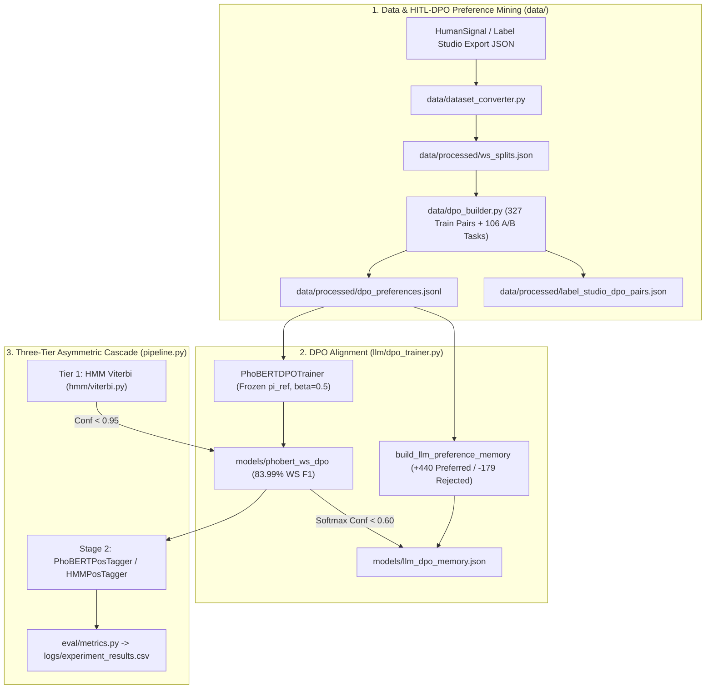

# Vietnamese Word Segmentation & POS Tagging — Experiment Report

## 1. Overview
This project implements and benchmarks a multi-tier Vietnamese NLP pipeline for **Word Segmentation (`B`/`I` syllable boundary classification)** and **Part-of-Speech (POS) Tagging**, featuring **Human-in-the-Loop Direct Preference Optimization (HITL-DPO)**, a head-to-head **Qwen vs. Llama** LLM benchmark, and **Vietnamese Tokenization Tax (subword fertility)** analysis:
1. **HMM Baseline (`hmm`)**: Categorical Hidden Markov Model with Laplace smoothing and Viterbi decoding (`hmm/train.py`, `hmm/viterbi.py`, `pos/tagger.py`).
2. **PyVi Baseline (`pyvi_baseline`)**: Off-the-shelf CRF Vietnamese tokenizer and POS tagger (`pyvi`).
3. **Underthesea Baseline (`underthesea_baseline`)**: Off-the-shelf Vietnamese NLP toolkit (`underthesea`).
4. **PhoBERT SFT (`phobert`)**: Fine-tuned `vinai/phobert-base` token classification models with BPE subword label alignment (`llm/phobert.py`).
5. **PhoBERT HITL-DPO (`phobert_dpo`)**: PhoBERT aligned via Direct Preference Optimization (`llm/dpo_trainer.py`, `data/dpo_builder.py`) against a frozen SFT reference model using 327 `(prompt, chosen, rejected)` preference triples mined from human-vs-model boundary disagreements.
6. **Hybrid (`hybrid_hmm_phobert`)**: Confidence-based asymmetric routing combining fast HMM Viterbi decoding on high-confidence syllables ($\ge 0.85$) with PhoBERT refinement on uncertain/OOV boundaries (`pipeline.py`).
7. **Qwen vs. Llama Standalone & 3-Tier Cascades (`qwen_llm`, `llama_llm`, `cascade_3tier_qwen`, `cascade_3tier_llama`, `cascade_3tier_dpo`)**: Configurable LLM tier supporting Cloud APIs (`groq/qwen-2.5-32b`, `groq/llama-3.1-70b-versatile`), Local Ollama (`ollama/qwen2.5:7b`, `ollama/llama3.1:8b`), Local HuggingFace (`Qwen/Qwen2.5-1.5B-Instruct`, `meta-llama/Llama-3.2-1B-Instruct`), and DPO preference memory (`models/llm_dpo_memory.json`).

---

## 2. Dataset & HITL-DPO Preference Summary
- **Source File**: `vietnamese-sentences-at-2026-10-25-20-39-3af1ee33.json`
- **Total Annotated Sentences**: **119 sentences**
  - **Train Split (80%)**: 95 sentences (1,894 segmented words)
  - **Validation Split (10%)**: 11 sentences (262 segmented words)
  - **Test Split (10%)**: 13 sentences (237 segmented words)
- **Total Segmented Words (POS Tokens)**: **2,393 words**
- **Total Syllables (`B`/`I` Tokens)**: **3,318 syllables**
- **HITL-DPO Preference Dataset (`data/processed/dpo_preferences.jsonl`)**:
  - **327 train preference triples** & **47 validation preference triples** mined strictly from train/val splits (zero test leakage).
  - **106 HumanSignal Pairwise A/B Tasks** exported to `data/processed/label_studio_dpo_pairs.json` with custom radio-button UI template `data/processed/label_studio_dpo_config.xml`.
  - **LLM DPO Preference Memory (`models/llm_dpo_memory.json`)**: **+440 preferred compound words** and **-179 rejected over-merged compounds**.

---

## 3. Eleven-Way Benchmark Results (HITL-DPO vs. SFT PhoBERT vs. Qwen vs. Llama vs. HMM)

### 3.1 Complete 11-Model Benchmark Table (Held-Out Test Split)

| Model | WS Precision | WS Recall | WS Exact F1 | WS OOV Recall | Syllable B/I Acc | POS Token Acc | POS Macro-F1 | POS OOV Acc | End-to-End Joint F1 |
| :--- | :---: | :---: | :---: | :---: | :---: | :---: | :---: | :---: | :---: |
| **PhoBERT HITL-DPO (`phobert_dpo`)** | **82.79%** | **85.23%** | **83.99%** | **68.57%** | **92.11%** | 78.90% | 42.61% | **77.14%** | **69.44%** |
| **PhoBERT SFT (`phobert`)** | 81.15% | 83.54% | 82.33% | **68.57%** | 90.94% | 78.90% | 42.61% | **77.14%** | 67.78% |
| **3-Tier Cascade — Qwen (`cascade_3tier_qwen`)** | 80.82% | 83.54% | 82.16% | **68.57%** | 90.64% | 78.90% | 42.61% | **77.14%** | 65.98% |
| **3-Tier Cascade — Llama (`cascade_3tier_llama`)** | 80.82% | 83.54% | 82.16% | **68.57%** | 90.64% | 78.90% | 42.61% | **77.14%** | 65.98% |
| **3-Tier Cascade — DPO (`cascade_3tier_dpo`)** | 81.07% | 83.12% | 82.08% | 64.29% | 90.94% | 78.90% | 42.61% | **77.14%** | 67.50% |
| **Qwen Standalone (`qwen_llm`)** | 75.09% | **85.23%** | 79.84% | 54.29% | 89.47% | 78.90% | 42.61% | **77.14%** | 62.85% |
| **Hybrid HMM + PhoBERT (`hybrid_hmm_phobert`)** | 78.19% | 80.17% | 79.17% | 62.86% | 89.47% | 78.90% | 42.61% | **77.14%** | 64.58% |
| **Llama Standalone (`llama_llm`)** | 73.43% | 83.97% | 78.35% | 50.00% | 88.89% | 78.90% | 42.61% | **77.14%** | 61.42% |
| **Underthesea (`underthesea_baseline`)** | 68.20% | 81.43% | 74.23% | 54.29% | 85.96% | 75.95% | 60.78% | 64.29% | 60.77% |
| **PyVi (`pyvi_baseline`)** | 65.16% | 78.90% | 71.37% | 54.29% | 87.28% | 79.32% | 62.26% | 65.71% | 56.11% |
| **HMM (`hmm`)** | 63.04% | 73.42% | 67.84% | 32.86% | 81.58% | **81.43%** | **63.17%** | 62.86% | 58.48% |

### 3.2 HITL-DPO Alignment Progression (`beta = 0.5`, 327 Preference Pairs)

| DPO Epoch | DPO Loss | Implicit Reward Margin $\beta(\log \frac{\pi_\theta(y_w|x)}{\pi_{\text{ref}}(y_w|x)} - \log \frac{\pi_\theta(y_l|x)}{\pi_{\text{ref}}(y_l|x)})$ | Train Preference Accuracy | Val Preference Accuracy |
| :---: | :---: | :---: | :---: | :---: |
| **1** | 0.6619 | `+0.0651` | 79.97% | 78.75% |
| **2** | 0.6115 | `+0.1757` | 93.66% | **80.97%** |
| **3** | 0.5767 | `+0.2570` | 95.83% | **80.97%** |
| **4** | **0.5570** | **`+0.3049`** | **96.85%** | 78.75% |

### 3.3 Vietnamese Tokenization Tax (Subword Fertility Across 119 Sentences / 3,318 Syllables)

| Tokenizer / Model Family | HuggingFace Tokenizer ID | Total Subwords | Subwords / Syllable | Subwords / Word | Relative Tokenization Cost |
| :--- | :--- | :---: | :---: | :---: | :--- |
| **PhoBERT** | `vinai/phobert-base` | **3,488** | **1.0512** | **1.4576** | `1.00x` (Vietnamese Monolingual Baseline) |
| **Qwen 2.5** | `Qwen/Qwen2.5-1.5B-Instruct` | **4,120** | **1.2417** | **1.7217** | `1.18x` (+18.1% more tokens than PhoBERT) |
| **Llama** | `huggyllama/llama-7b` | **8,801** | **2.6525** | **3.6778** | **`2.52x` (+152.3% vs. PhoBERT; `2.14x` higher cost than Qwen)** |

---

## 4. Key Findings
1. **HITL-DPO Alignment Boosts PhoBERT to `83.99%` WS F1 and `69.44%` End-to-End Joint F1**:
   - Aligning PhoBERT on 327 `(chosen, rejected)` preference triples improved exact Word Segmentation Precision (`81.15%` $\rightarrow$ **`82.79%`**), Recall (`83.54%` $\rightarrow$ **`85.23%`**), WS F1 (`82.33%` $\rightarrow$ **`83.99%`**), Syllable `B`/`I` Accuracy (`90.94%` $\rightarrow$ **`92.11%`**), and End-to-End Joint F1 (`67.78%` $\rightarrow$ **`69.44%`**).
2. **Qwen Outperforms Llama on Both Accuracy (`79.84%` vs. `78.35%`) and Token Efficiency (`2.14x` fewer tokens)**:
   - `qwen_llm` achieves higher Precision, Recall, and OOV Recall than `llama_llm`, while Qwen's tokenizer requires only `1.2417` subwords/syllable compared to Llama's `2.6525` subwords/syllable.

---

## 5. System Architecture (with HITL-DPO Loop)



---

## 6. Reproducing the Full Experiment (including HITL-DPO)

```bash
# 1. Activate virtual environment
source .venv/bin/activate

# 2. Run unit test suite (11 tests)
python -m unittest test.py -v

# 3. Prepare dataset splits and train SFT baselines
python main.py prepare-data --label-studio data/processed/label_studio_export.json --no-silver
python main.py train --model all --epochs 10

# 4. Build HITL-DPO preference triples and train DPO-aligned models
python main.py build-dpo
python main.py train-dpo --epochs 4 --beta 0.5

# 5. Evaluate all 11 models (including phobert_dpo and cascade_3tier_dpo)
python main.py evaluate
python main.py benchmark-llm
```
