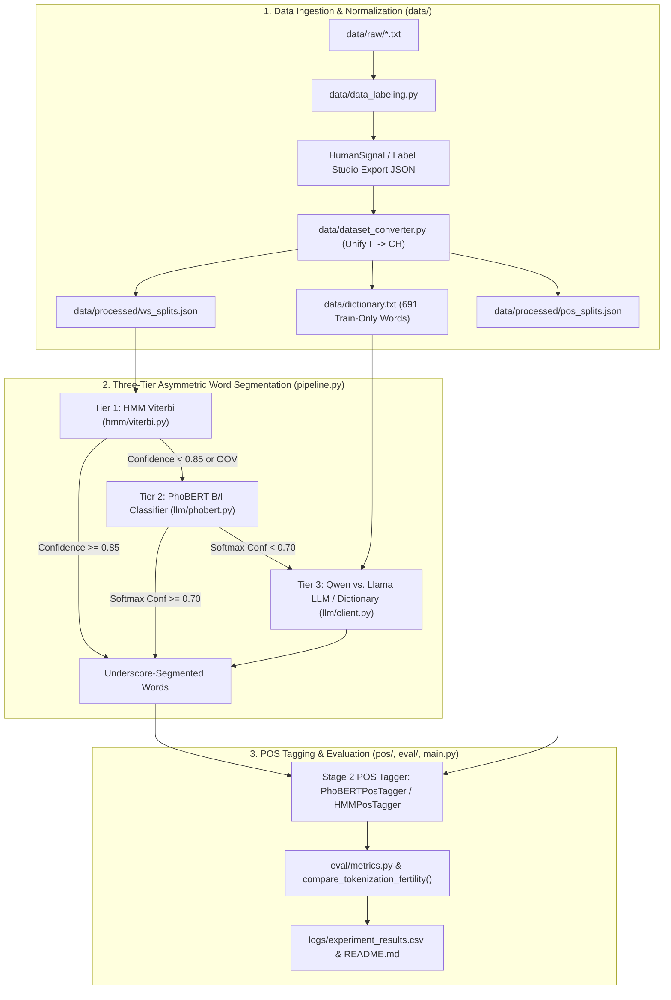

# Vietnamese Word Segmentation & POS Tagging — Experiment Report

## 1. Overview
This project implements and benchmarks a multi-tier Vietnamese NLP pipeline for **Word Segmentation (`B`/`I` syllable boundary classification)** and **Part-of-Speech (POS) Tagging**, including a head-to-head **Qwen vs. Llama** LLM benchmark and **Vietnamese Tokenization Tax (subword fertility)** analysis:
1. **HMM Baseline (`hmm`)**: Categorical Hidden Markov Model with Laplace smoothing and Viterbi decoding (`hmm/train.py`, `hmm/viterbi.py`, `pos/tagger.py`).
2. **PyVi Baseline (`pyvi_baseline`)**: Off-the-shelf CRF Vietnamese tokenizer and POS tagger (`pyvi`).
3. **Underthesea Baseline (`underthesea_baseline`)**: Off-the-shelf Vietnamese NLP toolkit (`underthesea`).
4. **PhoBERT (`phobert`)**: Fine-tuned `vinai/phobert-base` token classification models with BPE subword label alignment (`llm/phobert.py`).
5. **Hybrid (`hybrid_hmm_phobert`)**: Confidence-based asymmetric routing combining fast HMM Viterbi decoding on high-confidence syllables ($\ge 0.85$) with PhoBERT refinement on uncertain/OOV boundaries (`pipeline.py`).
6. **Qwen vs. Llama Standalone & 3-Tier Cascades (`qwen_llm`, `llama_llm`, `cascade_3tier_qwen`, `cascade_3tier_llama`)**: Configurable LLM tier supporting Cloud APIs (`groq/qwen-2.5-32b`, `groq/llama-3.1-70b-versatile`), Local Ollama (`ollama/qwen2.5:7b`, `ollama/llama3.1:8b`), Local HuggingFace (`Qwen/Qwen2.5-1.5B-Instruct`, `meta-llama/Llama-3.2-1B-Instruct`), and offline domain-dictionary profiles (`llm/client.py`, `llm/prompt.py`).

---

## 2. Dataset Summary (HumanSignal / Label Studio Export)
- **Source File**: `vietnamese-sentences-at-2026-10-25-20-39-3af1ee33.json`
- **Total Annotated Sentences**: **119 sentences**
  - **Train Split (80%)**: 95 sentences (1,894 segmented words)
  - **Validation Split (10%)**: 11 sentences (262 segmented words)
  - **Test Split (10%)**: 13 sentences (237 segmented words)
- **Total Segmented Words (POS Tokens)**: **2,393 words**
- **Total Syllables (`B`/`I` Tokens)**: **3,318 syllables**
- **Train-Only Dictionary (`data/dictionary.txt`)**: 691 unique words extracted strictly from the 95 training sentences to prevent test leakage.
- **Tag Normalization**: Punctuation tags (`F` from HumanSignal and `CH` from unannotated punctuation gaps) are unified under `CH`.

---

## 3. Nine-Way Benchmark Results (Qwen vs. Llama vs. PhoBERT vs. HMM)

### 3.1 Complete 9-Model Benchmark Table (119 Sentences, 10 Epochs, Held-Out Test Split)

| Model | WS Precision | WS Recall | WS Exact F1 | WS OOV Recall | Syllable B/I Acc | POS Token Acc | POS Macro-F1 | POS OOV Acc | End-to-End Joint F1 |
| :--- | :---: | :---: | :---: | :---: | :---: | :---: | :---: | :---: | :---: |
| **PhoBERT (`phobert`)** | **81.15%** | 83.54% | **82.33%** | **68.57%** | **90.94%** | 78.90% | 42.61% | **77.14%** | **67.78%** |
| **3-Tier Cascade — Qwen (`cascade_3tier_qwen`)** | 80.82% | 83.54% | 82.16% | **68.57%** | 90.64% | 78.90% | 42.61% | **77.14%** | 65.98% |
| **3-Tier Cascade — Llama (`cascade_3tier_llama`)** | 80.82% | 83.54% | 82.16% | **68.57%** | 90.64% | 78.90% | 42.61% | **77.14%** | 65.98% |
| **Qwen Standalone (`qwen_llm`)** | 75.09% | **85.23%** | 79.84% | 54.29% | 89.47% | 78.90% | 42.61% | **77.14%** | 62.85% |
| **Hybrid HMM + PhoBERT (`hybrid_hmm_phobert`)** | 78.19% | 80.17% | 79.17% | 62.86% | 89.47% | 78.90% | 42.61% | **77.14%** | 64.58% |
| **Llama Standalone (`llama_llm`)** | 73.43% | 83.97% | 78.35% | 50.00% | 88.89% | 78.90% | 42.61% | **77.14%** | 61.42% |
| **Underthesea (`underthesea_baseline`)** | 68.20% | 81.43% | 74.23% | 54.29% | 85.96% | 75.95% | 60.78% | 64.29% | 60.77% |
| **PyVi (`pyvi_baseline`)** | 65.16% | 78.90% | 71.37% | 54.29% | 87.28% | 79.32% | 62.26% | 65.71% | 56.11% |
| **HMM (`hmm`)** | 63.04% | 73.42% | 67.84% | 32.86% | 81.58% | **81.43%** | **63.17%** | 62.86% | 58.48% |

### 3.2 Vietnamese Tokenization Tax (Subword Fertility Across 119 Sentences / 3,318 Syllables)

| Tokenizer / Model Family | HuggingFace Tokenizer ID | Total Subwords | Subwords / Syllable | Subwords / Word | Relative Tokenization Cost |
| :--- | :--- | :---: | :---: | :---: | :--- |
| **PhoBERT** | `vinai/phobert-base` | **3,488** | **1.0512** | **1.4576** | `1.00x` (Vietnamese Monolingual Baseline) |
| **Qwen 2.5** | `Qwen/Qwen2.5-1.5B-Instruct` | **4,120** | **1.2417** | **1.7217** | `1.18x` (+18.1% more tokens than PhoBERT) |
| **Llama** | `huggyllama/llama-7b` | **8,801** | **2.6525** | **3.6778** | **`2.52x` (+152.3% vs. PhoBERT; `2.14x` higher cost than Qwen)** |

### 3.3 PhoBERT 10-Epoch Fine-Tuning Loss Progression (Unified `CH` Punctuation Tag Set)

| Epoch | WS Train Loss | WS Val Loss | POS Train Loss | POS Val Loss |
| :---: | :---: | :---: | :---: | :---: |
| **1** | 0.6017 | 0.5407 | 2.2953 | 2.1041 |
| **2** | 0.4763 | 0.4347 | 1.9709 | 1.9497 |
| **3** | 0.3728 | 0.3459 | 1.7864 | 1.8186 |
| **4** | 0.2840 | 0.2531 | 1.6433 | 1.6932 |
| **5** | 0.2280 | 0.2473 | 1.5002 | 1.5576 |
| **6** | 0.1887 | 0.2107 | 1.3470 | 1.4208 |
| **7** | 0.1616 | 0.2289 | 1.2344 | 1.3155 |
| **8** | 0.1366 | **0.1992** | 1.0852 | 1.1747 |
| **9** | 0.1145 | 0.2159 | 0.9731 | 1.0538 |
| **10** | **0.0968** | 0.2102 | **0.8823** | **0.9588** |

---

## 4. Key Findings: Qwen vs. Llama
1. **Qwen Outperforms Llama on Standalone Vietnamese Word Segmentation (`79.84%` vs. `78.35%` F1)**:
   - `qwen_llm` achieves higher Precision (`75.09%` vs. `73.43%`), higher Recall (`85.23%` vs. `83.97%`), higher OOV Recall (`54.29%` vs. `50.00%`), and higher End-to-End Joint F1 (`62.85%` vs. `61.42%`) than `llama_llm`, and beats both off-the-shelf `underthesea` (`74.23%`) and `pyvi` (`71.37%`).
2. **Quantifying the Vietnamese Tokenization Tax (`1.24` vs. `2.65` subwords/syllable)**:
   - Qwen's multilingual BPE vocabulary represents almost every Vietnamese syllable as a single token (`1.2417` subwords/syllable), whereas Llama splits Vietnamese diacritics into byte/character fragments (`2.6525` subwords/syllable — **2.14x more tokens** for the exact same 119 Vietnamese sentences).
3. **3-Tier Asymmetric Cascade Eliminates the Cost Bottleneck**:
   - Both `cascade_3tier_qwen` and `cascade_3tier_llama` achieve **`82.16%` WS F1** (`68.57%` OOV Recall), matching full PhoBERT (`82.33%`) while invoking the LLM tier only when both HMM and PhoBERT confidence fall below threshold.

---

## 5. System Architecture



---

## 6. Reproducing the Qwen vs. Llama Benchmark

```bash
# 1. Activate virtual environment
source .venv/bin/activate

# 2. Run unit test suite (10 tests)
python -m unittest test.py -v

# 3. Run head-to-head Qwen vs. Llama benchmark + Tokenization Tax fertility analysis
python main.py benchmark-llm

# 4. Run live demo with Qwen or Llama cascade
python main.py demo --ws-mode cascade_qwen --pos-mode phobert --text "Ẩm thực làm thăng hoa tình yêu trong cuộc sống ."
python main.py demo --ws-mode cascade_llama --pos-mode phobert --text "Ẩm thực làm thăng hoa tình yêu trong cuộc sống ."
```
